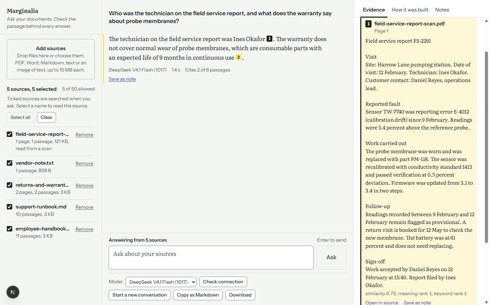
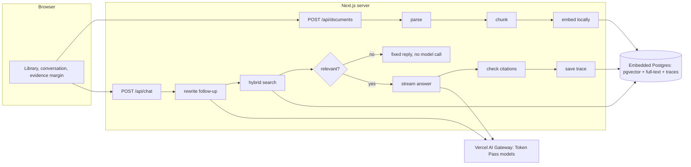

# Marginalia: chat with your documents

Option 1 of the AI FDE assignment. Upload PDFs, Word files, Markdown or text, ask questions, and get answers written only from those documents. Every claim carries a numbered citation, and the passage behind each number sits in the margin next to the answer.



## Quick setup

Requirements: Node.js 22 or later. No database or other service to install.

```bash
npm install
npm run dev                    # http://localhost:3000
```

`npm run dev` and `npm start` both pass `--hostname 127.0.0.1` to Next, so the server listens on this machine only and nothing on the network can connect to it.

Then connect a model from the screen: **Settings**, **Connection** (see [Connecting a model](#connecting-a-model)). No file to edit and no restart.

Click **Load five sample documents** in the left pane to try it without your own files. One of the five is a scanned page, so the app asks before it is read.

- **Without a model** the app still runs in offline mode: upload and search work, and answers are the best passages quoted as written. Scans and images need a model.
- **First upload** downloads the embedding model once (about 35 MB) into `.data/models`.

With Docker:

```bash
AI_GATEWAY_API_KEY=... docker compose up --build    # http://localhost:3000
```

Inside the container the server has to listen on every interface (`--hostname 0.0.0.0`), so the Connection panel is read-only there unless you set `SETTINGS_TOKEN` (24 characters or more, for example from `openssl rand -hex 24`) and type it into the panel. See [Who may change the connection](#who-may-change-the-connection).

Checks:

```bash
npm run check    # lint, type-check, 216 tests (no network, no key)
npm run eval     # retrieval quality on the sample documents; adds live answer, scan and guide checks if a key is set
npm run build
```

## Connecting a model

### In the app

Open **Settings** under the question box, then **Connection**. With no model connected, the notice at the top of the conversation has a **Connect a model** link to the same panel.

- **Provider:** Vercel AI Gateway, OpenAI, Anthropic, Google, or an OpenAI-compatible or local server.
- **API key:** stored on this machine and never shown again. Once a key is saved the field is empty and says "A key ending in ab12 is saved. Leave this empty to keep it." A local server needs none.
- **Server address:** only for the OpenAI-compatible or local choice. **Use Ollama** and **Use LM Studio** fill in `http://localhost:11434/v1` and `http://localhost:1234/v1`.
- **Model:** for the gateway, the app's own list. For the others, the model id as the provider names it, plus optional further ids for the picker.
- **Test and save** sends one short request with what you entered and saves only if the model answers. Otherwise it shows why and saves nothing, so a working connection is never replaced by a broken one. **Save without testing** skips the request. **Forget this connection** returns to whatever `.env.local` provides.
- The panel says which connection is in use and where it came from: "Set in this app", "From the settings file" or "No model connected", and "Local model, nothing leaves this machine" for a local address.

Saving takes effect on the next request. A connection saved in the app replaces the whole connection from the environment until it is forgotten.

How the key is kept:

- It is written to one file, `connection.json`, in the data folder (`.data`, gitignored), with owner-only permissions where the platform supports them. Windows ignores that mode, so there the file has the folder's permissions. It is plain text, like `.env.local`: anyone who can read the folder can read it.
- It never goes back to the browser. `GET /api/connection` returns the provider, the source, whether a key is set, the model ids and whether the model is local. The key's last four characters and the server address are added only for a local request in local mode, and in the reply to a save or forget that was allowed (see below); anyone else gets `null` for both. Keys under 12 characters and keys from the environment get no last-four hint, and an address is returned without any login, query string or fragment.
- It is handed to the provider's SDK directly and is never written into `process.env`.
- It is never logged. The logger removes a saved key from every line, and error text shown in the interface is cleaned the same way, because a provider can quote the key it was sent.
- Changing it is restricted, as described next.

#### Who may change the connection

The app has no login, so `PUT` and `DELETE /api/connection` are allowed in exactly two cases. Nothing a request says about itself can grant either one: a client can send `Host: localhost` as easily as anything else, so headers prove nothing about where a request came from. Headers are only ever used to refuse.

1. **A settings token is configured and sent.** Set `SETTINGS_TOKEN` in the server's environment: 24 characters or more (a shorter one stops the app at startup), for example the output of `openssl rand -hex 24`. Once a token is set it is required for every change, on a localhost server too. The panel then shows a **Settings token** field, keeps what you type in memory until the page is closed, and sends it in an `x-settings-token` header with a save or a forget. The server compares it in constant time and never logs or returns it.
2. **No token is set, and the server listens on 127.0.0.1 only.** Then only programs on this machine can connect at all. This is decided from how the server was started, not from the request. `npm run dev` and `npm start` start it this way. Two things still refuse a change here: a `Host` header that is not a local name, and any sign that the request passed through a proxy (both explained below).

Otherwise the request gets 403 and a message that says what to do: start the app on localhost, or set `SETTINGS_TOKEN`. The panel shows the same thing and disables its buttons. This is the case in Docker and with `--hostname 0.0.0.0` when no token is set.

**Attempts are limited before they are judged.** A save or a forget is checked in this order: another site (refused), the rate limit (`CONNECTION_RATE_LIMIT_PER_MINUTE`, 6 by default, shared by saves and forgets), who is asking, then the input. A refused attempt uses up allowance like any other, so a token cannot be guessed at speed; once the allowance is spent even the right token gets 429 until the minute is over. The cost of that choice: anyone who can reach the app can send a flood of refused requests and block connection changes from the panel for a minute at a time. The connection in use is not affected, and `.env.local` still works.

Details worth knowing:

- **How the server knows it is on loopback.** It reads `__NEXT_PRIVATE_ORIGIN`, which Next sets in the serving process from the address it bound. Measured on Next 16.4.6 under both `next dev` and `next start`: `--hostname 127.0.0.1` gives `http://127.0.0.1:<port>`; `--hostname 0.0.0.0` and no hostname both give `http://localhost:<port>`; `--hostname ::` gives `http://[::1]:<port>`. So only the literal `127.0.0.1` counts. `--hostname localhost` and `--hostname ::1` are loopback in fact but look the same as an open server, so they are treated as open and need the token. The command line is checked as well where it is visible (`next start`; the `next dev` worker does not receive it): a hostname flag other than `127.0.0.1` means not loopback. The `HOSTNAME` variable is not used: Next does not set it, and on Linux it is the machine's name. If a later Next drops the variable, the answer becomes "not loopback" and the token is required: it fails closed.
- **The Host header still has one job.** On a loopback server the remaining way in is a web page in this machine's browser that points its own domain at 127.0.0.1 (DNS rebinding). The browser then sends that domain as `Host`, so on a loopback server a change is also refused unless `Host` is `localhost`, `127.0.0.1` or `[::1]`. That stops a browser. It is not what keeps other machines out; the bind address is.
- **A reverse proxy on the same machine changes the picture.** The app then sees every visitor as a local program, so a request that shows any sign of a proxy is never treated as local: it needs the token, and with no token set it is refused with a message saying a proxy is in front. `Forwarded`, `X-Real-IP` and `Via` count by being present. `X-Forwarded-For`, `X-Forwarded-Host` and `X-Forwarded-Proto` need one qualification, because Next itself adds those three to every request that lacks them (the socket's address, the `Host` header and `http`): they count as a proxy's whenever they hold anything else, that is an address other than loopback or a list of addresses, a host that differs from `Host`, or `https`. What this cannot catch is a proxy that adds no such header at all and rewrites `Host` to a local name. Behind a proxy, set `SETTINGS_TOKEN`.
- **Reading** (`GET /api/connection`) is open to anyone who can reach the app, is not rate limited, never returns the key, and reports `changeAllowed`: `local`, `token` or `no`. The server address and the key's last four characters are included only for a local request in local mode (`changeAllowed: local`). A settings token is ignored on a read, right or wrong: the read is not rate limited, so a reply that changed for the right token would let anyone test guesses at it without limit. A token holder gets the two hints in the reply to a save or forget, which is rate limited. In token mode the panel therefore opens without them and shows them after a save.

#### Where a test request may go

**Test and save** makes the server send a request to the address in the form, so:

- **Refused addresses.** Link-local addresses (`169.254.0.0/16`, which holds the cloud metadata service at `169.254.169.254`, and `fe80::/10`), the metadata addresses outside that range (`100.100.100.200`, `fd00:ec2::254`), `0.0.0.0` and `::`, the same addresses written as IPv4-mapped IPv6, and the names `metadata`, `metadata.google.internal`, `metadata.azure.com`, `instance-data` and `instance-data.ec2.internal`. Loopback and private ranges stay allowed, because that is where a local model server lives.
- **Where the name leads.** Before a connection with a server address is tested or saved, its hostname is resolved and the connection is refused if any address it resolves to is one of the above. A literal IP address is checked as written and not looked up. A name that does not resolve fails **Test and save** as "not reachable", and is accepted by **Save without testing**, because a local server may simply be off. The name is resolved at check time, so a DNS answer that changes between the check and the call is not caught.
- **No redirects.** Requests to an OpenAI-compatible server, the test and every real call, refuse to follow a redirect, so that server cannot bounce the key and the passages to another address.
- A failed test returns one of a fixed set of sentences (key rejected, model id not known, rate limited, not reachable, timed out, failed with status N). Nothing from the other server's reply is passed to the browser, so the test cannot be used to read a server the browser cannot reach. **Check connection** uses the same sentences.

### In `.env.local`

The alternative, and what applies when nothing is saved in the app:

```bash
cp .env.example .env.local     # then put your AI Gateway key in .env.local, and restart
```

- **The key** is a [Vercel AI Gateway](https://vercel.com/docs/ai-gateway) key. A standard key or a Token Pass-scoped key both work.
- **A different key works too.** Set `OPENAI_API_KEY`, `ANTHROPIC_API_KEY` or `GOOGLE_GENERATIVE_AI_API_KEY` together with `CHAT_MODEL`, or point `LLM_BASE_URL` at any OpenAI-compatible server (OpenRouter, Groq, Ollama).
- **A model on your own machine works too**, with no key at all. See [Running fully local](#running-fully-local).

Either way, **Check connection** under the question box sends one tiny request to the connected model and reports the result.

## What it does

- **Answers with evidence.** Each answer cites numbered passages. The right pane lists the cited passages first and folds the retrieved-but-uncited ones away. A citation number and its passage share one selected state.
- **Source guide.** Before the first question, the right pane shows a short overview of the selected sources and three questions to try, written by the model from the opening passages of each source. It is stored and reused until the selection or the model changes. In offline mode it lists the sources and their passage counts and calls nothing.
- **Open a source.** Select a source's name to read its extracted text passage by passage. **Open in source** on an evidence card jumps to that passage. **Ask only this source** narrows the selection to it.
- **Notes.** **Save as note** keeps an answer or a passage, with the names and positions of its sources. Notes are stored in the database, survive a reload, and outlive the source they came from (the note then says the source was removed).
- **Export.** **Copy as Markdown** and **Download** write the conversation and the notes to one Markdown file with a single numbered source list.
- **The conversation survives a reload.** It is kept in the browser's local storage until **Start a new conversation**.
- **Scans, with permission.** A file with pages only the model can read is not sent anywhere until you agree: read this file, always read scans this session, or skip it.
- **Password-protected PDFs.** The upload row asks for the password, uses it once to open the file, and does not keep it.

## Architecture

One Next.js app. Route handlers are thin; the logic is in plain TypeScript modules under `src/lib` that tests call directly.



| Path | What it holds |
| --- | --- |
| `src/lib/ingest` | File parsers, the chunker, the upload pipeline |
| `src/lib/retrieval` | All SQL, the keyword-query builder, rank fusion, hybrid retrieval and the relevance gate |
| `src/lib/generation` | Prompts, the chat handler, citation checking |
| `src/lib/ai` | Model list and prices, the local embedder, the provider resolver, the connection saved from the settings panel, the local-address check, error translation |
| `src/lib/notebook` | Source guide, notes, the Markdown export, the stored conversation |
| `src/components` | The three panes of the interface, plus the guide, notes and source views shown in the right pane |
| `evals` | Golden questions and the evaluation runner |

## RAG and LLM decisions

### LLM: Token Pass models through Vercel AI Gateway

- **Final choice:** `deepseek/deepseek-v4.1-flash-1017` by default, with the other Token Pass models (GLM 5.3, GLM 5.3 Flash, Kimi K3, Kimi K3.1 Pro) selectable in the interface.
- **Why the gateway:** one key reaches several providers, it fails over between them, and it logs every request with tokens and cost. Token Pass requests have zero data retention, which matters when the documents are internal.
- **Why a small fast model:** the task is to report what six passages say. That needs instruction-following more than deep reasoning, and a fast model keeps the wait short. The model picker makes it easy to compare a larger model on the same question.
- **Considered:** calling one provider's SDK directly (simpler, but one vendor and no shared logging), and a larger default model (slower and about ten times the price for little gain on this task).
- **Guard:** the browser can only request models from a server-side allowlist (`CHAT_MODELS`).
- **Reasoning is switched off** for gateway models (`REASONING=none`). The task is to report what the passages say. With reasoning on, the default model sometimes spent its whole output budget thinking and returned no text.
- **Other providers:** OpenAI, Anthropic, Google and any OpenAI-compatible endpoint are selected from the settings panel or the environment by a small resolver (`src/lib/ai/provider.ts`). The gateway path is the one tested end to end. The OpenAI, Anthropic and OpenAI-compatible adapters were each exercised with a live call against the gateway's compatible endpoints (`evals/providers.eval.ts`), which proves the adapter code and not those vendors' own servers. The Google adapter has not been run.
- **Connection saved in the app:** verified live for the gateway and for the OpenAI-compatible adapter pointed at the gateway (see [Quality controls](#quality-controls)). Saving an OpenAI, Anthropic or Google key from the panel is covered by unit tests that check each SDK is handed the key; none of the three was called with a real key.

### Embeddings: `bge-small-en-v1.5`, run locally

- **Final choice:** `Xenova/bge-small-en-v1.5` (384 dimensions) through ONNX on CPU.
- **Why local:** Token Pass covers chat models only, and a Token Pass-scoped key is rejected by embedding endpoints. Local embeddings also mean documents are never sent anywhere at indexing time, and indexing is free.
- **Cost of that choice:** indexing uses CPU. On a 2011 quad-core it takes about 0.2 s per passage; a modern laptop is several times faster.
- **Considered:** `openai/text-embedding-3-small` through the gateway (better multilingual quality, no local model, but needs gateway credit and sends every passage out), and `all-MiniLM-L6-v2` (twice as fast, but reads only 256 tokens, shorter than a passage).
- **Limits:** English only, 512 word pieces per passage. The index is stored per embedding model, so changing `EMBEDDING_MODEL` starts a clean index.

### Vector database: Postgres with pgvector, embedded

- **Final choice:** [PGlite](https://pglite.dev) (Postgres compiled to WebAssembly) with the pgvector extension, stored in `.data`.
- **Why:** vectors, full-text search, document records and traces live in one store, queried with ordinary SQL. The same statements run on a managed Postgres, so production changes the driver and not the queries. Tests run against the real engine in memory.
- **Considered:** Qdrant or a hosted vector database (another service to run and keep in sync with document records), LanceDB (embedded, but a second store would still be needed for records), and plain in-memory arrays (no persistence, no filters).
- **No ANN index, on purpose:** an exact scan is more accurate and fast enough up to tens of thousands of passages. HNSW is the first change at larger scale.

### Retrieval: hybrid search with rank fusion

- Two searches run side by side: nearest neighbours by cosine distance, and Postgres full-text search with the question's terms OR-ed.
- Their rankings are merged with Reciprocal Rank Fusion, which uses positions only, so the two score scales never need calibrating.
- The top 6 passages go to the model.
- **Why hybrid:** embeddings find paraphrases; keyword search finds exact strings such as `E-4012` that embeddings blur. Testing this surfaced a real bug: Postgres parses `E-5100` as the letter E and the number -5100, so the code was unfindable until punctuation was normalised before indexing.
- **Known limit:** Postgres full-text ranking is not BM25 (no inverse document frequency). Fusion with the vector leg hides most of that; a BM25 extension is the upgrade.

### Chunking

- Markdown and Word files are split by heading, then paragraph; PDFs by page, then paragraph. Sentences are never cut unless a single sentence exceeds a whole chunk.
- A chunk never crosses a heading, so its heading path (`Handbook › Leave › Carry-over`) describes all of it.
- Target 280 tokens, maximum 400, with about 50 tokens of overlap inside a section.
- The document name and heading path are prepended to the text that gets embedded, not to the text that is stored.
- **Known limit:** PDF headings are not recovered, only page numbers.

### Scans and images

- A PDF page with a text layer is read directly: exact and free.
- A page with no text layer, or an uploaded PNG, JPEG or WebP, is rendered to an image and transcribed by the chat model, then indexed like any other text. The library marks such documents "read from a scan".
- **Why the chat model and not a separate OCR engine:** it is already connected, it is covered by the same key, and on the samples it read a scanned page correctly in about two seconds for roughly $0.0003. A local engine such as Tesseract would add a large dependency and reads tables and poor scans worse.
- **Permission first.** Reading a scan sends page images to the model, so the server does nothing with such a file until the request carries `allowScan=true`. Without it the upload ends with a `needs_scan_permission` event that says how many pages are scans and where their images would go, and nothing is stored. The interface turns that into three choices in the file's upload row. "Always" is remembered in session storage only. A PDF that mixes text pages and scanned pages is all or nothing: skipped, none of it is indexed, because half a file that looks whole gives quietly wrong answers.
- **Password-protected PDFs.** pdf.js reports "a password is needed" and "that password is wrong" separately; the upload ends with `needs_password` and the row asks (again, if it was wrong). The password travels as a form field, opens the file for text extraction and for page rendering, and is never stored, logged or echoed back. A test reads the ingest log line and the response to prove it. A password-protected Word file is a different container (it starts with the bytes `D0 CF 11 E0`); it is recognised and refused with instructions to remove the password in Word, with no extra library.
- **Limits:** at most 20 scanned pages per file (`OCR_MAX_PAGES`), a model must be connected, and the page image is sent to the model. Each page is rendered within a pixel budget (`OCR_MAX_PAGE_PIXELS`, 16 million): a larger page is rendered at a lower scale, and a page that would not fit even at its own size is refused, because a PDF can declare a page of any size. A transcription can contain mistakes that direct extraction cannot, so answers from scans deserve a closer look at the evidence. Handwriting is untested.

### Source guide

- One structured call (`generateText` with `Output.object` and a Zod schema) returns an overview and three questions. A reply that misses the schema is retried once; after that the pane shows the error with a retry button.
- **Bounded input.** The model sees at most the first three passages of each selected source, inside a fixed character budget (`GUIDE_INPUT_CHARS`, 12,000) shared equally between sources, so the cost does not grow with the library.
- **Cached.** The result is stored under a hash of the sorted document ids plus the model id. The same selection never pays twice; only a guide that has to be written counts against the rate limit.
- **Untrusted.** The passages go to the model inside `<source>` tags with the same escaping as answers, and the guide comes back as model output about untrusted documents, so the interface renders it as plain text.

### Running fully local

A local model already works through the OpenAI-compatible adapter, with no key. Embeddings are always computed on this machine, so with a local chat model nothing leaves it: not the documents, not the questions, not scanned pages.

From the screen: **Settings**, **Connection**, choose **OpenAI-compatible or local server**, press **Use Ollama** or **Use LM Studio**, type the model id and save. Or in `.env.local`:

```bash
# .env.local, Ollama
LLM_BASE_URL=http://localhost:11434/v1
CHAT_MODEL=llama3.2

# LM Studio
LLM_BASE_URL=http://localhost:1234/v1
CHAT_MODEL=<the model id LM Studio shows>

# vLLM
LLM_BASE_URL=http://localhost:8000/v1
CHAT_MODEL=<the model name vLLM was started with>
```

- Leave every hosted key (`AI_GATEWAY_API_KEY` and the others) unset, or add `LLM_PROVIDER=openai-compatible`, because the gateway is preferred when its key is present.
- `LLM_API_KEY` is only needed if your server asks for one.
- The app treats the model as local when the server address (`LLM_BASE_URL`, or the address saved in the panel) points at `localhost`, `127.0.0.1`, `::1` or a private network address. `/api/health` then reports `"local": true`, the question box shows **Local model**, and the scan prompt says the pages are read on this machine.
- **Scans and images need a model that accepts images** (for example a vision model in Ollama). A text-only model will fail on them with the provider's error; text files are unaffected.
- **`REASONING`** defaults to `default` for this provider, which sends no reasoning setting. If your model spends its whole output budget thinking and returns nothing, set `REASONING=none`; if your server rejects that setting, leave it out.
- The source guide asks for JSON matching a schema. Small local models miss it more often; the guide then shows an error and answers still work.

**What was verified:** this path was exercised only against the gateway's OpenAI-compatible endpoint (`evals/providers.eval.ts`), which proves the adapter code. It was not run against Ollama, LM Studio or vLLM, because no local server was available on the build machine. The local-address detection is unit tested.

### Prompt and context management

- The system prompt is a constant with no per-request text, so the provider can cache it.
- Passages are sent only in the current turn, inside numbered `<source>` tags. Earlier turns are sent as plain question and answer text, capped at 2,000 characters each and six turns.
- A follow-up such as "and for contractors?" is rewritten into a standalone search query by one short model call. The rewrite is used for search only; if it fails, the question is searched as typed.

### Guardrails

| Risk | Control |
| --- | --- |
| Off-topic question | Relevance gate: if the best similarity is under 0.5 and no keyword matched, a fixed reply is returned and the model is not called |
| Instructions hidden in a document | Passages are wrapped in `<source>` tags, the prompt says to treat them as data, and neither the text nor its heading or file name can close the tag. A sample document contains such an instruction and the evaluation checks the answer ignores it |
| Made-up citations | Every answer is checked after generation. Numbers that match no passage are not clickable and are flagged; an answer with no citation gets a visible warning |
| Oversized or wrong input | File type, 15 MB size and library limits; question length limit; request schema validation |
| Runaway cost | Separate rate limits for questions, uploads (`INGEST_RATE_LIMIT_PER_MINUTE`), connection checks (`HEALTH_CHECK_RATE_LIMIT_PER_MINUTE`), connection saves and guides, each one shared budget by default and per client behind a trusted proxy; output token cap; model allowlist. The library-size limit is checked before a file is parsed, so a full library refuses a scan without a model call |
| Page images sent without consent | A scan is read only when the request carries permission; otherwise the server stores nothing and calls nothing |
| A PDF that declares an enormous page | Scanned pages are rendered within a pixel budget; an absurd page is refused |
| Passwords | Used once to open the file; never stored, logged or returned. The field is capped at 500 characters |
| Model text about documents shown as markup | The source guide and notes are rendered as plain text |
| Model output that phones home | Images in answers are dropped and links are shown as text, so a document cannot make the browser send conversation data to another site |
| Oversized uploads | The request is refused by declared size before it is read; PDFs over 300 pages and files with more than 1.5 million characters of text are rejected |
| Requests from other sites | Uploads, deletes, questions and connection changes are refused when a browser sends them from a different origin, so a page in another tab cannot drive the app |
| A web page reading the documents through DNS rebinding | A page can point its own domain at 127.0.0.1, and its requests then look same-origin to the browser. Every API route sits behind `src/proxy.ts`, which refuses a request whose `Host` is not in `ALLOWED_HOSTS` (`localhost`, `127.0.0.1` and `[::1]` by default, any port) |
| Someone else changing or reading the model key | `PUT` and `DELETE /api/connection` are allowed only when the request carries `SETTINGS_TOKEN` (24 characters or more, compared in constant time, always required once set), or when no token is set and the server listens on 127.0.0.1 alone (decided from how it was started, never from request headers). In that second case a change is still refused if the `Host` header is not a local name, which stops a web page using a rebinding domain, or if the request shows any sign of a proxy; those header checks only ever refuse and are not authorization. Saves and forgets share one rate limit (`CONNECTION_RATE_LIMIT_PER_MINUTE`) that is applied before authorization, so refused attempts use it up. Input is schema-checked (provider from a fixed list, bounded key and model ids, `http` or `https` address with no login in it), a failed test saves nothing, and neither the key nor the token is ever returned, logged or put in an error message |
| A visitor learning where the model server is | Reading the connection returns the server address and the key's last four characters only to a local request in local mode; a token holder gets them in the reply to an allowed save or forget. A settings token is ignored on a read, so the unlimited read cannot be used to test guesses at it |
| The connection test used to reach other servers | Link-local and cloud metadata addresses and names are refused as a server address, and so is a name that resolves to one of them (checked when the connection is tested or saved, not again at each call); requests to an OpenAI-compatible server do not follow redirects; a failed test or connection check returns a fixed sentence and nothing from the upstream reply |
| Empty selection | Unticking every document is refused, never treated as "search everything" |
| Half-indexed documents | A document is searchable only after all its passages are stored; a failed upload is marked failed and its passages removed |

The gate is a cost filter that prefers answering, not a correctness check. It can miss when an answer is spread thinly across passages.

### Quality controls

- **216 unit and integration tests** run with a fake embedder and a scripted model against in-memory Postgres: no network, no key. They cover the handlers as black boxes (upload, chat, guide, notes, connection check, connection settings), the pure functions, and each pane rendered to HTML with fixed props. For the connection settings: the loopback decision for every command line and environment shape, the table of who may change the connection (loopback with a local or foreign `Host`, not loopback with no token, a right, wrong or missing token, a token required on loopback once set, each proxy header), that refused attempts use up the rate limit and the right token is then refused too, the address blocklist for addresses as written and as resolved, an unresolvable name, the redirect-refusing fetch, precedence of the app over the environment, that the public view and every response and log line are free of the key and the token, that a failed test saves nothing and repeats nothing from the upstream reply, and that each provider SDK is handed the saved key.
- **Connection settings, live** (one run against the dev server on 127.0.0.1, with the gateway key): the connection read as coming from the environment; the gateway connection saved from the endpoint with the test on, a question then answered with `token-pass` in its trace; the read showed only the key's last four characters; a wrong key was refused and the file left unchanged; an OpenAI-compatible connection pointed at `https://ai-gateway.vercel.sh/v1` saved and answered a question; a `PUT` with `Host: example.com` got 403; forgetting removed `connection.json` and the source returned to the environment. No response and no server log line contained the key. This run was made before the rule for who may change the connection was replaced; the saves and the refusals were repeated under the new rule, below, but the two questions were not asked again.
- **Who may change the connection, live** (port 3101, raw HTTP requests so the `Host` header could be set freely):
  - `npm run dev` and `npm start` (both loopback): a save from `Host: localhost` with the test on was allowed and written; `PUT` and `DELETE` with `Host: example.com` got 403; `169.254.169.254` and `metadata.google.internal` were refused as addresses; an unreachable address, a wrong gateway key and an address that answered 404 each produced a fixed sentence.
  - `next start --hostname 0.0.0.0`, `next dev --hostname 0.0.0.0` and `next dev` with no hostname, no token: `PUT` with `Host: localhost`, `127.0.0.1` and `[::1]`, `PUT` with a made-up token and `DELETE` all got 403, and nothing was written.
  - `next start --hostname 0.0.0.0` and `next dev --hostname 0.0.0.0` with `SETTINGS_TOKEN` set: without the header 403, with a wrong token 403, with the token a save and then a forget were allowed.
  - In every run no response and no server log line contained the key or the token, and `connection.json` was gone at the end.
  - The runs above were made before a configured token became required on a localhost server too and before the rate limit moved ahead of authorization. Those two changes, and the address checks, were verified in the next run.
- **Proxy signs, the limit and the address checks, live** (port 3101, raw HTTP requests, under both `npm run dev` and `npm start`):
  - No token: a `PUT` carrying `X-Forwarded-For: 1.2.3.4` got 403 with the proxy message, and so did one each carrying `X-Forwarded-Host`, `X-Forwarded-Proto: https`, `Forwarded`, `X-Real-IP` and `Via`; a normal local `PUT` with the test on was still allowed and written, and a normal local `DELETE` forgot it.
  - No token: `http://169.254.169.254/v1`, `http://100.100.100.200/v1`, `http://[fd00:ec2::254]/v1`, `http://0.0.0.0:11434/v1`, `http://metadata.azure.com/v1` and `http://instance-data/v1` were each refused with 400; a name that does not resolve got 422 with the test on and was saved with it off; `http://localhost:9/v1` resolved and was saved.
  - `SETTINGS_TOKEN` set on loopback, default limit of 6: without the header 403; with it a save and a forget were allowed; three wrong tokens then got 403 and the next three 429; the correct token then got 429 as well.
  - No response and no server log line contained the key or the token, and `connection.json` was gone at the end.
- **Retrieval evaluation** (`npm run eval`): 16 golden questions over the sample documents. Current result: hit@1 0.94, hit@3 1.00, MRR 0.97.
- **Answer evaluation** (same command, runs when a key is set): checks expected facts, that an out-of-scope question is declined, and that the hidden instruction is not followed. 4 of 4 passed on the last run.
- **Scan and guide evaluation** (`evals/notebook.eval.ts`, same command): the scanned sample is refused without permission with no page sent, then read with permission, and a question about it is answered with a citation to it; the source guide returns an overview and three questions that name topics from the samples, and the second request is served from the stored copy. Both passed on the last run.
- **Provider adapters** (`evals/providers.eval.ts`): 4 of 4 passed against the gateway's compatible endpoints.

The golden set is small and was written alongside the sample documents. It is a regression check, not evidence of quality on real corpora.

**Checked in a browser:** loading the samples, the scan permission prompt, the source guide, and a cited answer drawing on the scanned page and a PDF, at desktop width, plus the layout at phone width. The Connection panel was opened and shows the connection in use.

**Not verified:** focus movement, clipboard copy, the file download, the password prompt, and pressing **Test and save** in the panel were not clicked through in a browser, nor was the panel at phone width; they are covered by the HTML each pane renders and by tests of every endpoint behind it. A local model server was not available either (see [Running fully local](#running-fully-local)), so saving an Ollama or LM Studio connection from the panel is untested against a real server. A name that resolves to a refused address, and a server that answers with a redirect, were exercised only in unit tests (with a stand-in resolver and a stand-in fetch): the live run had no DNS name to point at a link-local address and no second port for a redirecting server. No real reverse proxy was put in front of the app; proxy headers were sent by hand. The settings token was verified with raw requests, not by typing it into the panel, and not inside the Docker container, which was not built in this pass. The loopback signal was measured on Windows with Next 16.4.6 only. The owner-only file mode was not observed on disk: the build machine runs Windows, which ignores it.

### Observability

- One JSON log line per answer: trace id, outcome, model, provider, per-stage timings, passages retrieved, best similarity, tokens, estimated cost, citation result.
- The same trace is stored and shown in the right pane's **How it was built** tab. `GET /api/traces` lists recent traces when `ENABLE_TRACE_API=true`; it is off by default because traces contain the questions asked.
- One log line per indexed document and per guide written (model, sources, input size, attempts, time).
- `GET /api/health` reports mode, models, index size, whether the model is local and where the connection came from (`connectionSource`: `app`, `env` or `none`).
- One log line per connection saved, refused by its test, or forgotten: provider, model and whether a key is present, never the key.
- The gateway dashboard is the source of truth for spend.

## Key technical decisions

| Decision | Why |
| --- | --- |
| No orchestration framework | The pipeline is five small functions. Plain code is easier to read, test and debug than LangChain or LlamaIndex abstractions at this size |
| One Next.js app in TypeScript | One language, one install, one container; the AI SDK gives typed streaming to the browser |
| Evidence and trace travel on the answer stream | Passages appear before the answer text, and there is no second request to keep in sync |
| Offline mode | The app is usable with no key, which also keeps CI free of secrets |
| Cost estimated from a price table | Visible per answer without an extra API call; unknown models show no cost instead of a wrong one |
| Schema version check, no migrations | The index can be rebuilt from the documents, so a clear "delete `.data`" message is enough at this stage |

## Productionising on AWS

The same design maps to managed services. GCP and Azure have direct equivalents.

| Concern | Change |
| --- | --- |
| Compute | The container on ECS Fargate behind an ALB, autoscaled on CPU |
| Database | RDS or Aurora PostgreSQL with pgvector. Same SQL; swap the PGlite handle for a `pg` pool; add an HNSW index |
| Uploads | Original files to S3; ingestion moves to a worker fed by SQS, so a large upload cannot block a web request |
| Embeddings | A dedicated embedding service or a hosted embedding API, so indexing scales separately from the web tier |
| Secrets | The gateway key in Secrets Manager, or OIDC where supported |
| Tenancy and auth | OIDC login; a tenant id on every row with row-level security; per-tenant rate limits in Redis |
| Observability | OpenTelemetry traces and metrics to CloudWatch or Grafana; alerts on error rate, latency and refusal rate |
| Quality gate | The evaluation runs in CI against a fixed corpus and blocks a deploy when scores drop |
| Delivery | Images built in CI, pushed to ECR, deployed with a rolling update |

Today the app is single-process by design: one container and one volume, because the embedded database allows one writer.

## Engineering standards

**Followed**

- Strict TypeScript, ESLint, no `any` in application code.
- Framework-free core with dependencies passed in, so tests need no mocks of Next.js.
- All SQL in one file, parameterised.
- Configuration validated at startup; secrets come from the environment or from the connection saved in the app; `.env.local` and the data folder are gitignored.
- CI runs lint, type-check, tests, build and a Docker build with a health check.

**Skipped, deliberately**

- Authentication and multi-tenancy. Anyone who can reach the app can add and remove documents, so `npm run dev`, `npm start` and Docker Compose all listen on localhost only. Add a login before exposing it. The model connection is the one thing that stays protected when the server is opened to the network (it then needs `SETTINGS_TOKEN`), but a shared token is not a login, and with no token set, a same-machine reverse proxy that adds no forwarding header and rewrites `Host` leaves the app unable to tell a visitor from a local program.
- Encrypting the saved key. `connection.json` is plain text with owner-only permissions, the same exposure as `.env.local`. A hosted deployment should use a secrets manager instead.
- Database migrations.
- Browser end-to-end tests (the streams are tested at the HTTP layer and the panes as rendered HTML instead).
- Notes are plain text and cannot be edited beyond their title. The conversation is kept per browser, not per account, because there are no accounts.
- A guard against compression bombs. A Word file is a zip, and the text limit is checked after it is unpacked, so a small hostile file could use a lot of memory first. On an app only its owner can reach that is a risk to yourself; before opening uploads to others I would check the declared sizes in the zip first and parse in a worker with a memory cap.
- Image size optimisation.
- Tables as structured data, handwriting, and non-English text.

## How AI tools were used

Claude Code wrote the code, tests and documentation in this repository. It ran on Claude Fable 5.2 for most of the build and Claude Opus 5.5 at the end. My part was to set the direction, make the decisions and test the result.

I set the constraints early. No Claude model runs inside the app. The model comes through the Vercel AI Gateway Token Pass with DeepSeek V4.1 Flash as the default, and embeddings run locally because the pass only covers chat models. I asked for a plan and the request flow before any code was written, then ran the first version myself before deciding what came next.

Using it shaped the second pass. I asked for images and scanned PDFs to be read, with permission asked first, and for a password prompt on protected files. I wanted failed uploads to be removable and the limits to be visible. I also asked for other providers and local models, a NotebookLM style workspace, a design review by a second model, and a way to connect a model from inside the app.

Nothing generated was taken on trust. Every change had to pass lint, type checks, the offline tests and a production build, and was then tried against the running app with real model calls and in a browser. Library APIs were read from the docs shipped with the installed packages, since several had changed since the model was trained.

The AI did get things wrong. The first version of the connection panel decided whether a request came from this machine by reading the Host header, which any client can fake. Automated security reviews caught that and two smaller gaps after it, and the panel now relies on the address the server was started on or on a settings token. DeepSeek also returned empty answers at first because its reasoning used up the whole output budget, so reasoning is now switched off.

## What I would do differently with more time

I would check every citation against the passage it points to, not just that the number exists, and add a reranking step if it proves worth the extra wait. I would recover headings and tables from PDFs, move ingestion into a background job that can resume, and build the test questions from real use with a faithfulness score. Before anyone other than me could reach the app, I would also put a real login in front of the connection settings.
